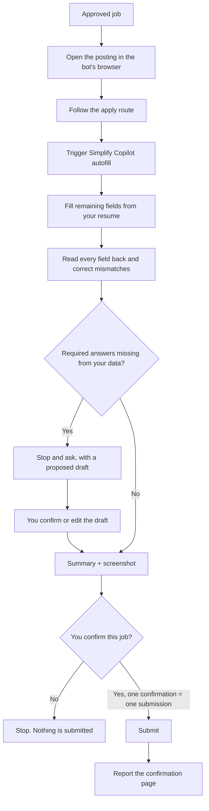

# jobapplicatoooor

A Grok Bot whose one job is to submit job applications, and only for jobs you already approved. A companion scout bot, [JobFather](https://github.com/simo255/jobfather), finds and briefs roles. This bot opens the posting in its browser, lets Simplify Copilot autofill what it can, fills the rest from your real resume, reads every field back, and submits only after you confirm that one job.

Built for [Grok Bot](https://cursor.com).

## How it works

LinkedIn to an external ATS such as Greenhouse is a common apply route. The bot follows it instead of stopping on the job board.

## Features

- Applies only to jobs you already approved. It does not search for jobs.
- Follows the apply route, including LinkedIn to an external ATS
- Triggers Simplify Copilot autofill, and chooses the minimal option on Simplify's data-consent prompt
- Fills remaining fields from your real resume and saved facts
- Reads every field back, corrects mismatches against the resume, and flags discrepancies
- Stops and asks, with a proposed draft, when a required answer is not in your data (salary, work authorization or sponsorship, office days, years of experience, essays). Never guesses.
- Sends a summary and screenshot, then submits only after your explicit confirmation for that job. One confirmation equals one submission.
- Reports the confirmation page after submit
- Vault-first logins. If a credential is missing, it asks through a secure form. Passwords never go in chat, and failed logins are not retried in a loop.
- Flags default-checked extras, such as a LinkedIn continue screen that may share your profile by default

## What's in this repo

| Path | What it is |
|------|------------|
| `persona/JOBAPPLICATOOOR.md` | Full bot persona / instructions to paste into a Grok Bot |
| `LICENSE` | MIT |

Nothing here is a live resume, fact record, screenshot, credential, or session.

## Setup

1. Create a new Grok Bot named jobapplicatoooor (or your preferred name).
2. Paste `persona/JOBAPPLICATOOOR.md` into the bot description / persona field.
3. Install [Simplify Copilot](https://chromewebstore.google.com/detail/simplify-copilot-autofill/pbanhockgagggenencehbnadejlgchfc) from the Chrome Web Store into **the bot's Chrome**, not only the browser on your own computer. The bot cannot use an extension installed on a different machine.
4. Hand the bot's screen so you can sign in to Simplify once yourself. After that, the session is reused.
5. Send your resume and any saved application facts to the bot in chat. Those stay in the bot's private memory. They are not part of this repository.
6. Pair it with a scout bot such as [JobFather](https://github.com/simo255/jobfather), or send it a posting URL for a job you have already approved.

### Verified dry run

This flow was verified on a real posting that routed from LinkedIn to an external ATS. After Simplify Copilot was installed in the bot's Chrome and signed in, autofill triggered. Remaining fields were filled from the resume, mismatches were corrected, and required questions not in the owner's data were left for confirmation. The run stopped before submit.

## Safety rules

- It never searches for jobs. A companion scout bot, or you, brings it an approved posting.
- It never submits without your explicit confirmation for that exact job. One confirmation is one submission, not a blanket go-ahead.
- It never guesses a required answer that is not in your data. It stops, proposes a draft, and waits.
- It never creates accounts without asking first.
- It never messages recruiters, makes payments, or edits your resume.
- Credentials stay in the vault. They never go in chat, memory, files, or GitHub.
- This public repo must never contain resumes, personal data, answers, credentials, session state, screenshots, or application records.

## Limitations

- Simplify autofill only knows what is saved in the signed-in Simplify profile. Incomplete profiles leave more fields for the bot to fill or to ask about.
- Autofill can still get fields wrong (salary, sponsorship, custom questions). The read-back step is required and is not skipped.
- LinkedIn "continue" screens may share your profile by default. The bot flags default-checked extras and waits for you when those settings matter.
- Some postings require a login, a captcha, or a custom question the resume does not cover. The bot stops and asks instead of improvising.
- The bot does not search for jobs or tailor your resume. That stays with you or with a scout bot such as JobFather.

## Credits

- Autofill: [Simplify Copilot](https://chromewebstore.google.com/detail/simplify-copilot-autofill/pbanhockgagggenencehbnadejlgchfc) (Chrome extension by [Simplify Jobs](https://simplify.jobs/copilot))
- Companion scout: [JobFather](https://github.com/simo255/jobfather)
- Runtime: Grok Bot / Cursor

## License

MIT. See [LICENSE](LICENSE).
