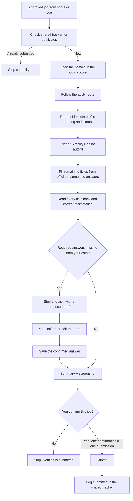

# jobapplicatoooor

A Grok Bot whose one job is to submit job applications, and only for jobs you already approved. A companion scout bot, [JobFather](https://github.com/simo255/jobfather), finds and briefs roles. When you OK a job, JobFather logs it as approved in a shared private tracker and hands the posting URL here. This bot checks the tracker, opens the posting in its browser, lets Simplify Copilot autofill what it can, fills the rest from your official resume and confirmed answers, reads every field back, and submits only after you confirm that one job.

Built for [Grok Bot](https://cursor.com).

## How it works



LinkedIn to an external ATS such as Greenhouse is a common apply route. The bot follows it instead of stopping on the job board.

## Features

- Applies only to jobs you already approved, including jobs handed over by a scout bot. It does not search for jobs.
- Checks the shared tracker before every submission so the same job is not applied to twice, and logs the result after submit
- Uploads the official resume from the shared folder, never the resume stored inside Simplify
- Follows the apply route, including LinkedIn to an external ATS
- Turns off LinkedIn profile sharing and other default-checked extras
- Triggers Simplify Copilot autofill, and chooses the minimal option on Simplify's data-consent prompt
- Fills remaining fields from the official resume and confirmed answers
- Uses the full legal name exactly as it appears in the official resume and answers; never shortens a name or picks between conflicting values
- Reads every field back and corrects mismatches
- When a job needs a French resume, translates the official HTML faithfully (no new facts), shows it to you once, then reuses it
- Stops and asks, with a proposed draft, when a required answer is not in your data (salary, work authorization or sponsorship, office days, years of experience, essays). Never guesses. Saves confirmed answers.
- Sends a summary and screenshot, then submits only after your explicit confirmation for that job. One confirmation equals one submission.
- Reports the confirmation page after submit
- Vault-first logins. If a credential is missing, it asks through a secure form. Passwords never go in chat, and failed logins are not retried in a loop.

## What's in this repo

| Path | What it is |
|------|------------|
| `persona/JOBAPPLICATOOOR.md` | Full bot persona / instructions to paste into a Grok Bot |
| `skills/jobapplicatoooor-workflow/SKILL.md` | Application workflow skill |
| `examples/answers.example.md` | Fictional answers template for the shared private folder |
| `examples/tracker.csv` | Empty tracker header for the shared private folder |
| `examples/shared-folder-README.md` | README template for the shared private folder |
| `LICENSE` | MIT |

Nothing here is a live resume, fact record, screenshot, credential, or session.

## Shared private folder

Both [JobFather](https://github.com/simo255/jobfather) and jobapplicatoooor read and write a private folder that is **not** part of this repository. Pick a path both bots can access, for example `~/job-private/`, and record that path in each bot's private memory.

Suggested layout (see `examples/shared-folder-README.md`):

- Official resume: a PDF plus its HTML source. This bot uploads that file, never the resume stored inside Simplify. If a job needs a French resume, it translates the HTML faithfully (no new facts), shows you the PDF once, then reuses it.
- `answers.md`: owner-confirmed facts and answers only. Pending items stay blank. Start from `examples/answers.example.md`.
- `tracker.csv`: every job briefed, approved, or submitted. Header:

  ```
  date_et,company,role,posting_url,job_id,status,by_bot,resume_file,confirmation
  ```

  Start from `examples/tracker.csv`.

The bot checks this tracker before every submission. If the same company and role, or the same job id, is already submitted, it stops and tells you. After a confirmed submission, it appends a `submitted` row.

Keep this folder private. Never commit it, and never put real answers or a resume in this public repo.

## Setup

1. Create a new Grok Bot named jobapplicatoooor (or your preferred name).
2. Paste `persona/JOBAPPLICATOOOR.md` into the bot description / persona field.
3. Copy `skills/jobapplicatoooor-workflow/SKILL.md` into the bot's skills.
4. Point the bot at the same shared private folder used by [JobFather](https://github.com/simo255/jobfather) (or create one from the examples above) and send your official resume if it is not already there.
5. Install [Simplify Copilot](https://chromewebstore.google.com/detail/simplify-copilot-autofill/pbanhockgagggenencehbnadejlgchfc) from the Chrome Web Store into **the bot's Chrome**, not only the browser on your own computer. The bot cannot use an extension installed on a different machine.
6. Hand the bot's screen so you can sign in to Simplify once yourself. After that, the session is reused.
7. Pair it with a scout bot such as [JobFather](https://github.com/simo255/jobfather), which hands over approved jobs directly, or send it a posting URL for a job you have already approved.

## Safety rules

- It never searches for jobs. A companion scout bot, or you, brings it an approved posting.
- It never submits without your explicit confirmation for that exact job. One confirmation is one submission, not a blanket go-ahead.
- It never guesses a required answer that is not in your data. It stops, proposes a draft, and waits.
- It never shortens your legal name or picks between conflicting values on its own.
- It never creates accounts without asking first.
- It never messages recruiters, makes payments, or rewrites your resume beyond a faithful translation when a job needs one.
- Credentials stay in the vault. They never go in chat, memory, files, or GitHub.
- This public repo must never contain resumes, personal data, answers, credentials, session state, screenshots, or application records.

## Limitations

- Simplify autofill only knows what is saved in the signed-in Simplify profile. Incomplete profiles leave more fields for the bot to fill or to ask about. The official resume in the shared folder is always the source of truth for the upload.
- Autofill can still get fields wrong (salary, sponsorship, custom questions, name format, links). The read-back step is required and is not skipped.
- LinkedIn "continue" screens may share your profile by default. The bot turns profile sharing and other default-checked extras off unless you said otherwise.
- Some postings require a login, a captcha, or a custom question the resume does not cover. The bot stops and asks instead of improvising.
- The bot does not search for jobs or tailor your resume. That stays with you or with a scout bot such as JobFather.

## Credits

- Autofill: [Simplify Copilot](https://chromewebstore.google.com/detail/simplify-copilot-autofill/pbanhockgagggenencehbnadejlgchfc) (Chrome extension by [Simplify Jobs](https://simplify.jobs/copilot))
- Companion scout: [JobFather](https://github.com/simo255/jobfather)
- Runtime: Grok Bot / Cursor

## License

MIT. See [LICENSE](LICENSE).
